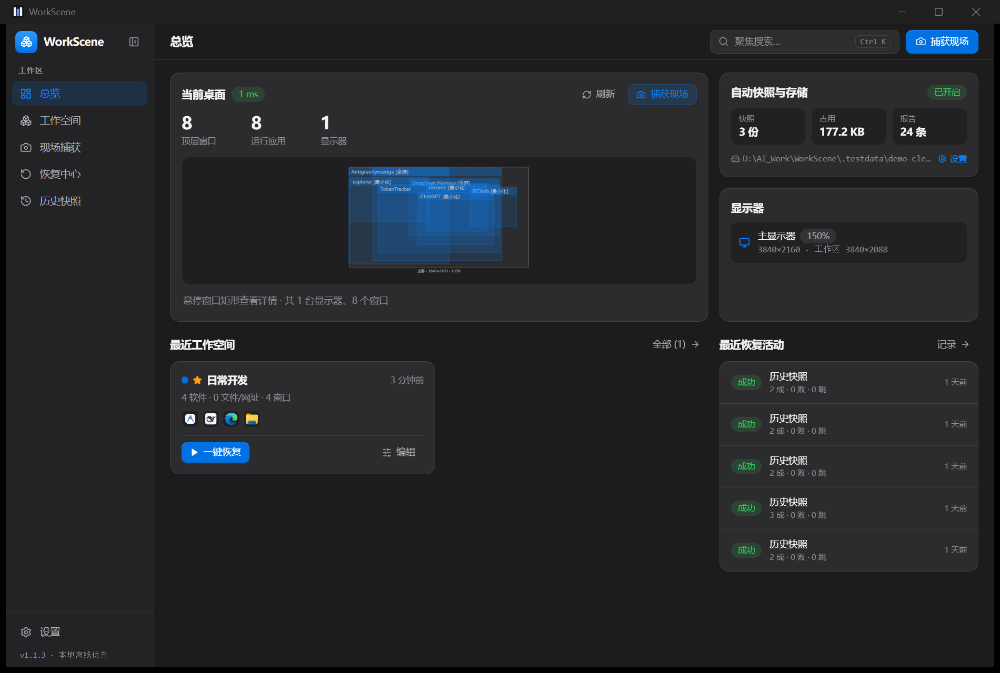
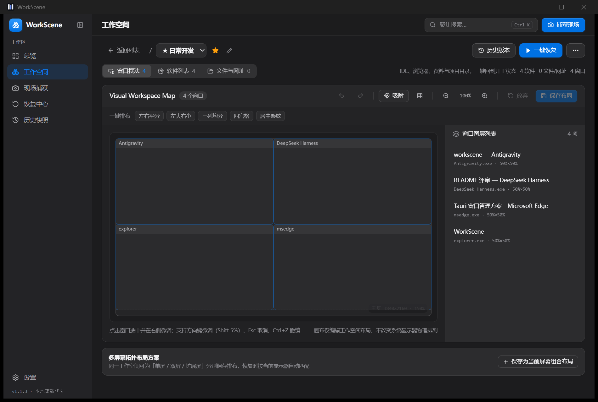
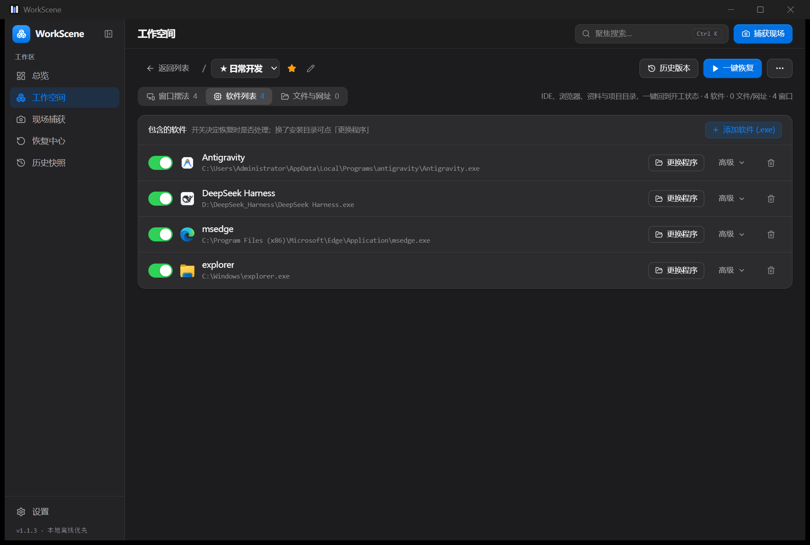
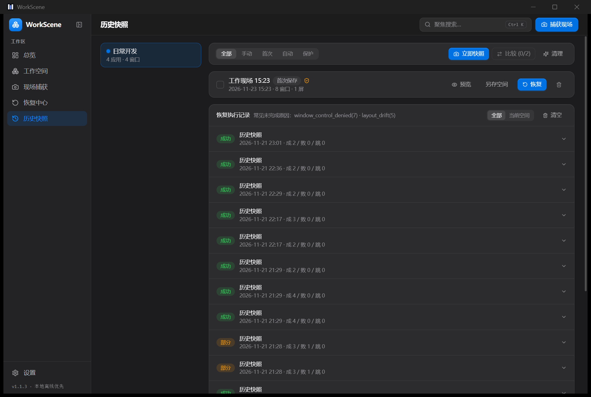
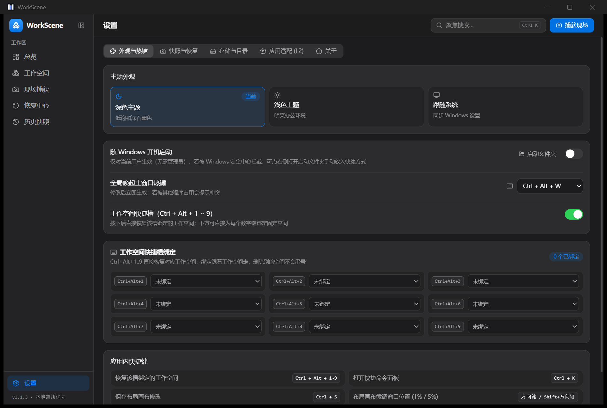

<div align="center">


# WorkScene

**把整套桌面工作现场，保存成可一键切换的工作空间**

Windows 10 / 11 · 本地优先 · 无需账号 · 数据不出本机

[](https://github.com/fanfanhappy/workscene/releases/latest)
[](https://github.com/fanfanhappy/workscene/releases)
[]()
[]()
[]()
[](LICENSE)

[下载安装](#下载与安装) · [界面预览](#界面预览) · [快速上手](#快速上手) · [快捷键](#快捷键) · [版本记录](docs/RELEASE.md) · [问题反馈](https://github.com/fanfanhappy/workscene/issues)

</div>

---

## 为什么需要 WorkScene？

写代码、做设计、查资料、写文档，一天里我们会在几套完全不同的桌面状态之间来回切换。每次切换都要重复一遍：

1. 逐个打开 IDE、浏览器、终端和参考文档，再把项目目录重新找出来；
2. 在多块屏幕之间拖拽、分屏、对齐每一个窗口；
3. 换到下一项工作时，又得把满屏窗口一个个收起或关掉。

**WorkScene** 把「应用 + 窗口位置与尺寸 + 多屏拓扑 + 项目目录 + 参考网页」整体保存为一个**工作空间（Workspace）**。需要时一键恢复：按优先级拉起缺失的程序、把窗口摆回原来的像素位置、打开关联的目录与网址；每次恢复前自动生成保护快照，整个过程**可预览、可诊断、可撤销**。



---

## 核心能力

### 01 · 现场捕获：连上下文一起保存

- **窗口扫描**：调用 Win32 原生 API 枚举可见、最大化与最小化窗口，自动过滤 `DWMWA_CLOAKED` 的其他虚拟桌面窗口和系统后台幽灵窗口。
- **L2 上下文识别**：扫描时自动读出已打开的资源管理器目录，以及 VS Code / Cursor / Windsurf / Trae / Antigravity 当前编辑的项目路径，保存时自动转成启动参数或目录资源。
- **降噪与忽略名单**：内置系统窗口过滤规则；聊天工具、音乐播放器等常驻软件可加入全局捕获忽略名单。

### 02 · 一键恢复：缺什么补什么

- **三种实例策略**：「缺几个补几个（默认）」「仅复用已打开窗口」「总是新开实例」。对已有实例的浏览器、IDE 与终端自动注入多开参数（`--new-window`、`-n`、`-w new`）。
- **启动编排**：每个应用可单独设置启动优先级与等待延迟，例如先等服务就绪，再拉起依赖它的客户端。
- **0px 贴边**：用 `DWMWA_EXTENDED_FRAME_BOUNDS` 补偿 Windows 透明阴影边框，配合 Per-Monitor V2 DPI 换算，消除两侧分屏与贴边时的 7~14px 缝隙。
- **专注模式 / 一键收工**：恢复时可把非本空间窗口安静收起到任务栏（不强关软件）；收工时向本空间窗口发送标准 `WM_CLOSE`，有未保存文档会正常弹出保存提示。

### 03 · 画布编排与多屏方案

- **Visual Workspace Map**：拖拽移动、缩放、边缘磁性吸附、网格辅助线；5 种一键分屏模板（左右平分 / 左大右小 / 三列均分 / 四宫格 / 居中叠放）；支持百分比精确输入与 30 步 `Ctrl+Z` / `Ctrl+Y` 撤销重做。
- **多屏拓扑方案（Display Profiles）**：同一个工作空间可以为「公司双屏」「笔记本单屏」「居家带鱼屏」分别保存布局；恢复时按当前显示器签名自动匹配对应方案。

### 04 · 资源联动与生命周期钩子

- **文件、目录与书签**：关联本地文件与文件夹、批量粘贴网址，或只读扫描并导入本机 Chrome / Edge 的书签文件夹（不读取密码、Cookie 或历史记录）。
- **生命周期钩子**：可为工作空间配置「恢复前」与「收工后」静默执行的本机命令（如 `docker start dev-db`）；默认关闭，外部导入的工作空间会自动停用，需手动确认。

### 05 · 快照、对比与诊断

- **多重快照保护**：手动快照、后台定时自动快照（指纹去重 + 保留上限），以及每次恢复 / 覆盖前的自动保护快照。
- **差异对比与另存**：可视化预览任意快照，对比两个快照的新增 / 移除 / 位置变化 / 状态变化，并把历史快照另存为新的工作空间。
- **逐步恢复诊断**：恢复中心展示每个窗口的匹配依据、耗时与像素偏差；未成功的项支持单条重试、仅重试未完成项、一键去修复路径或撤销本次恢复。

---

## 界面预览

| 窗口摆法画布 | 软件列表 |
|---|---|
|  |  |

| 历史快照 | 设置 |
|---|---|
|  |  |

> 截图取自 v1.1.3，Windows 11 深色主题，150% 缩放。

---

## 下载与安装

前往 [GitHub Releases](https://github.com/fanfanhappy/workscene/releases/latest) 下载最新版本（当前正式版 **v1.1.3**）。

| 版本形态 | 文件名 | 适用场景 |
|---|---|---|
| **标准安装版**（推荐） | `WorkScene_1.1.3_x64-setup.exe` | NSIS 当前用户安装，无需管理员权限，带开始菜单快捷方式与标准卸载。数据默认在 `%LOCALAPPDATA%\WorkScene`。 |
| **绿色便携版** | `WorkScene-1.1.3-portable.zip` | 解压即用。双击 `start.cmd` 启动时自动使用同目录 `data\`，整个文件夹可拷入 U 盘或同步盘随身迁移。 |

- **系统要求**：Windows 10 / 11（x64）；安装包会在缺少 WebView2 Runtime 时自动下载安装（需联网）。
- **完整性校验**：最新 Release 附带 `SHA256SUMS.txt`，下载后可执行 `certutil -hashfile <文件名> SHA256` 对照。

> **Windows SmartScreen 提示**：当前构建没有购买商业 EV 代码签名。首次运行安装包或主程序时若出现「Windows 已保护你的电脑」，请点 **「更多信息」→「仍要运行」**。

---

## 快速上手


1. **捕获现场**：打开平时工作要用的软件并排好位置，点击右上角 **「捕获当前现场」**，勾选窗口与自动识别出的项目 / 文件夹，命名保存。
2. **编排微调**：进入「工作空间」详情页——
   - **窗口摆法**：用一键模板或拖拽调整比例，`Ctrl+S` 保存；多屏办公可点「保存为当前屏幕组合布局」；
   - **软件列表**：补上未被打开的程序，展开高级选项设置启动顺序与延迟；
   - **文件与网址**：添加文档、导入浏览器书签，或配置恢复前 / 收工后的钩子命令。
3. **日常切换**：
   - `Ctrl+Alt+W` 唤起主窗口，`Ctrl+K` 打开命令面板；
   - 给高频工作空间绑定 `Ctrl+Alt+1~9` 快捷槽，无需打开主界面即可切换；
   - 右键托盘图标可直接恢复常用工作空间，或立即给当前桌面拍一张快照。

---

## 快捷键

| 快捷键 | 作用域 | 功能 |
|---|---|---|
| `Ctrl + Alt + W` | 全局 | 唤起 / 聚焦主窗口（可改为 `Ctrl+Shift+W`、`Ctrl+Alt+Space` 或关闭） |
| `Ctrl + Alt + 1 ~ 9` | 全局 | 在后台恢复对应快捷槽绑定的工作空间 |
| `Ctrl + K` | 应用内 | 命令面板：搜索工作空间、一键恢复、页面跳转、切换主题 |
| `Ctrl + S` | 布局页 | 保存当前画布的窗口位置与尺寸 |
| `Ctrl + Z` / `Ctrl + Y` | 布局页 | 撤销 / 重做画布操作（`Ctrl + Shift + Z` 亦可重做） |
| `↑ ↓ ← →` | 布局页 | 按 `1%` 步进微调选中窗口（`Shift + 方向键` 为 `5%`） |
| `Esc` | 应用内 | 按层级关闭顶层弹窗、命令面板，或取消画布选中 |

---

## L2 应用适配矩阵

WorkScene 按可执行文件名识别常见生产力工具，并给出经过验证的启动参数（只建议、不覆盖用户已填内容）：

| 类别 | 已适配代表软件 | 适配能力 |
|---|---|---|
| **代码编辑器 / AI IDE** | VS Code (`Code.exe` / Insiders)、Cursor、Windsurf、Trae、Antigravity | 自动识别当前工作区目录；补启窗口时注入 `-n` 并传入项目路径 |
| **JetBrains IDE** | IntelliJ IDEA、PyCharm、WebStorm、GoLand、CLion、Rider、RustRover、DataGrip、PhpStorm | 把项目文件夹路径直接作为启动参数打开工程 |
| **浏览器** | Chrome、Microsoft Edge、Brave、Arc、Vivaldi、Firefox、Opera、360 浏览器 | 导入 Chrome / Edge 书签夹；多窗口恢复时注入 `--new-window`（Firefox 为 `-new-window`） |
| **终端** | Windows Terminal (`wt.exe`)、PowerShell、pwsh、CMD | `wt.exe` 生成 `-w new -d "<目录>"`，`pwsh` 使用 `-WorkingDirectory`，新窗口直接进入目标目录 |
| **文件资源管理器** | Windows Explorer (`explorer.exe`) | 通过 COM 采集已打开窗口的真实文件夹路径，恢复时精准打开目录 |

---

## 隐私与安全

- **100% 本地**：工作空间、快照 JSON 与恢复记录（SQLite，WAL 模式）全部存放在本机；没有账号体系、云端同步或后台遥测。
- **最小采集**：不截屏、不注入其他进程、不读取浏览器 Cookie / 密码库 / 浏览历史。浏览器书签导入只读解析书签文件。
- **外部导入防护**：导入他人分享的工作空间 JSON 时会先预检；指向 UNC 网络路径、不存在的路径、带自定义启动参数或钩子命令的条目默认停用或剥离，确认后才启用。
- **唯一的网络请求**：仅当点击「设置 → 关于 → 检查新版本」时，前端会向 `api.github.com` 查询一次最新版本号，只读、不带任何用户数据。

### Windows 能力边界

1. **UIPI 权限隔离**：以普通用户运行时，无法移动或关闭「以管理员身份运行」的窗口（恢复报告会明确标注）。需要管理提权窗口时，请以管理员身份运行 WorkScene。
2. **UWP / 商店应用**：托管在 `ApplicationFrameWindow` 下的 UWP 应用暂不支持独立进程拉起与布局恢复，扫描时会识别并列入排除项。
3. **微型浮层**：小于 `120×90` 的悬浮窗、`WS_EX_TOOLWINDOW` 工具条与托盘弹窗会被过滤，不纳入工作空间。

---

## 已知限制

- **未在真实双屏 / 混合 DPI 环境做过完整验证**：显示器匹配、比例换算与线程级 DPI 上下文均已实现，但只有单屏 3840×2160 @150% 的实测数据。
- **开机启动**在部分受管环境可能被安全软件或组策略拦截：程序会如实报错，并提供「打开启动文件夹」的手动兜底。
- **安装包未签名**，首次运行会遇到一次 SmartScreen 提示；暂不支持自动更新。
- 恢复记录只展示最近 10 次；快照按工作空间计算保留数量。
- 最小化窗口恢复为普通窗口，报告中以 `stateRestored=false` 说明，不谎报成功。

---

## 架构与本地开发

```text
WorkScene/
├── src/                          # React 19 + TypeScript 前端
│   ├── components/               # AppShell / LayoutEditor / MonitorCanvas / CommandPalette / OnboardingModal
│   ├── pages/                    # Overview / Workspaces / Capture / Restore / History / Settings
│   ├── services/api.ts           # 唯一的 Tauri IPC 封装层
│   ├── stores/                   # Zustand UI / 主题 / 弹窗 / Toast
│   ├── styles/                   # Tailwind CSS 4 与深浅色设计令牌
│   └── types/contract.ts         # 与后端严格对齐的数据契约
├── src-tauri/                    # Rust + Tauri 2 后端
│   ├── migrations/               # SQLite 迁移（只追加）
│   └── src/
│       ├── adapters/             # L2 应用识别与启动参数
│       ├── capture/              # 窗口枚举与上下文识别
│       ├── commands/             # Tauri 命令入口
│       ├── core/                 # 领域模型与错误类型
│       ├── data/                 # SQLite 访问层
│       ├── restore/              # 恢复引擎 / 匹配器 / 坐标换算
│       ├── storage/              # 原子化快照读写
│       └── win/                  # Win32 / DWM / DPI / 热键 / 托盘 / 自启 / 书签
├── docs/                         # 发布说明、架构决策（ADR）与验证清单
└── .github/workflows/            # CI 与 Windows 打包发布流水线
```

**环境要求**：Windows 10 / 11 (x64)；Node.js 20+、pnpm 9+；Rust stable (MSVC)、Visual Studio C++ Build Tools、WebView2 Runtime。

```powershell
# 安装依赖
pnpm install

# 开发模式（前端热更新 + Rust 增量编译）
pnpm tauri dev

# 质量检查：前端类型/生产构建 + Rust 单元测试
pnpm build
cd src-tauri; cargo test --lib; cd ..

# 本地打包（产物在 src-tauri/target/release/bundle/nsis/）
pnpm tauri build
```

数据契约、存储选型与恢复策略见 [`docs/adr/`](docs/adr)；发布流程见 [`docs/RELEASING.md`](docs/RELEASING.md)。

---

## 常见问题

<details>
<summary><b>Q1：开启「随 Windows 开机启动」时提示注册表或启动文件夹被拦截？</b></summary>

安全软件（Windows Defender 文件夹限制访问、360、火绒等）可能拦截向 `HKCU\...\Run` 或系统「启动」文件夹写入。WorkScene 会自动在「注册表 → 启动文件夹 `.vbs`」之间降级尝试；两路都被拦截时，设置页会提供 **「打开启动文件夹」** 按钮，把 `WorkScene.exe` 的快捷方式手动放进去即可。
</details>

<details>
<summary><b>Q2：换电脑或重装系统，如何迁移所有工作空间？</b></summary>

打开 **「设置 → 存储与目录」→「导出全部备份」**，会把工作空间、窗口布局、多屏方案、资源与钩子打包成一个 `.json`；在新机器上「导入备份」即可还原。使用便携版时，直接把整个文件夹复制过去即可。
</details>

<details>
<summary><b>Q3：笔记本拔掉外接显示器后，原来在副屏的窗口会跑丢吗？</b></summary>

不会。目标显示器不存在时，恢复引擎会把窗口按比例安全回退到当前主显示器的工作区，并在报告中说明显示器变化；也可以为单屏 / 双屏分别保存拓扑方案。
</details>

<details>
<summary><b>Q4：为什么恢复报告里有窗口显示「跳过」或权限不足？</b></summary>

以管理员身份运行的窗口受 UIPI 保护，普通权限的 WorkScene 无法移动它们；UWP 应用与部分自绘窗口也不支持精确定位。报告会给出具体原因，可按提示重试或手动处理。
</details>

<details>
<summary><b>Q5：软件真的不联网吗？</b></summary>

除「检查新版本」按钮触发的一次 GitHub API 查询外，程序不发起任何网络请求；没有遥测、崩溃上报或账号登录。断网环境下所有功能（除检查更新）均可正常使用。
</details>

---

## 版本与更新

- 完整变更记录：[`docs/RELEASE.md`](docs/RELEASE.md)
- 历史版本与安装包：[GitHub Releases](https://github.com/fanfanhappy/workscene/releases)
- 每个版本单独的发布说明：[`docs/releases/`](docs/releases)

---

## 参与贡献

欢迎提交 Issue 与 Pull Request：

1. 先开 Issue 说明问题或需求，避免大改动方向不一致；
2. Fork 后从 `main` 切分支，提交前确保 `pnpm build` 与 `cargo test --lib` 通过；
3. PR 描述写清楚「改了什么、为什么、怎么验证」，涉及 UI 的请附截图。

如果你只是想让自己的桌面切换更顺手，也欢迎在 Issue 里附上你的应用组合与显示器配置——这些真实场景比任何基准测试都有价值。

---

## 许可

本项目以 [MIT License](LICENSE) 开源，可自由使用、修改与分发（保留版权与许可声明）。

WorkScene 是一个独立的第三方桌面工具，与 Microsoft、GitHub 及文中提到的其他软件厂商无隶属关系；相关商标归各自所有者所有。
